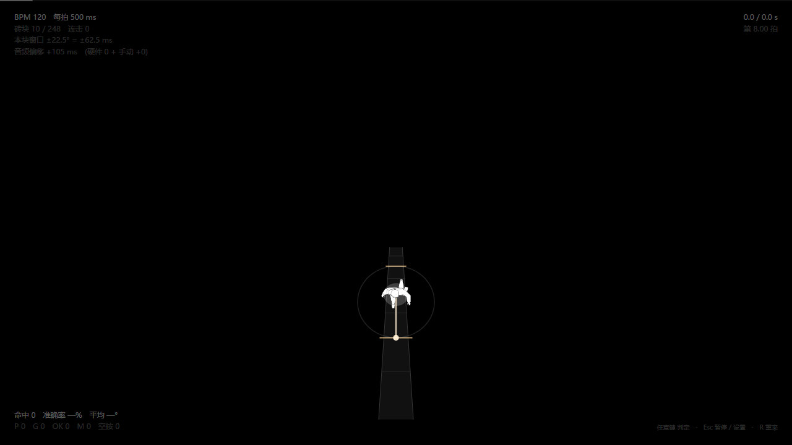

# 美术需求 · 失明前的局内画面

> 一句话：**玩家要靠这张画面判断「该在哪一刻敲下去」。** 好看是第二位的，第一是**看得清落点**。

---

## 一、画面构成

俯视图 + 伪透视（像 Mode 7）：摄像机在角色斜后方上方，路往画面深处延伸。

```
┌──────────────────────────┐
│                          │  ← 远处（路收窄、消失在地平线）
│         ▓▓▓▓             │  地平线在屏幕高度 33%
│        ▓▓▓▓▓▓            │
│       ▓▓▓▓▓▓▓▓           │
│      ▓▓▓▓▓▓▓▓▓▓          │  角色在屏幕高度 66%
│         ◉ 角色            │
│        ▓▓▓▓▓▓            │  ← 近处（路被放大）
└──────────────────────────┘
```

角色脚下有一圈**盲杖扫过的环**（透视下是椭圆）。

---

## 二、要画的素材

尺寸都给两种：**世界单位**（代码用的）和**建议像素**（1080p 屏幕上 1 格 ≈ 180 px）。

| 素材 | 世界单位 | 建议尺寸 | 说明 |
|---|---|---|---|
| **路砖 / 路面** | 路宽 **1.5**，一格长 **6** | **512×128** | 一格是 **4:1 的长条**，不是正方形；转弯处还会变成梯形 |
| **砖缝** | 每 **1.5** 单位一道 | 可画进路砖贴图 | 一格内有 4 块砖，**中间那道缝才是落点** |
| **落点标记** | 略宽于路宽 | — | **常驻的瞄准提示**，玩家要敲的地方。必须比砖缝明显 |
| **角色** | 直径 **2.6** | **512×512** | 俯视，背对镜头。目前是**浅色剪影** |
| **盲杖扫过的环** | 半径 **3**（半格） | — | 透视椭圆，线宽约 1–2 px |
| **井盖** | 半径 **≤ 2.25**（0.375 格） | **256×256** | 圆形，压在路面让出的方口里。目前用 1.6（0.27 格）|
| **转向箭头** | 长 **5** | **256×256** | 折角 = 这一格实际转过的角度，**不是固定 90°** |

**比例参照**：一格 6 世界单位，角色占 2.6（约 43% 格宽），路宽 1.5（约 1/4 格）。

---

## 二·五、三件容易搞混的事

**① 路砖不是正方形。**
每段路 = 长 6 × 宽 1.5 = **4 : 1 的长条**，转弯处还会变成**梯形**（相邻两段斜接）。
所以贴图不能依赖严格长宽比 —— 画成「拉伸得不太狠就不会烂」的图案。

**② 砖缝可以直接画进路砖贴图。**
但记住：**一格 = 4 块砖**，玩家真正要敲的是**一格的中点**，
也就是第 2 块和第 3 块砖之间那道缝。
4 道缝里只有中间那道是落点 —— 砖缝越均匀，玩家越分不清，
这正是「落点标记」必须存在、而且必须更显眼的原因。

**③ 落点标记是「提示」，不是「反馈」。**
- 落点标记：**常驻**的瞄准线，每个未来格子一条，一直亮着
- 打击反馈：敲中瞬间弹出的 PERFECT / GOOD **文字**（代码画，不用美术）

---

## 三、三条硬约束

**① 路砖必须能沿弯道平铺。**
路是**根据谱面程序化生成**的，会任意转弯。所以别画成"一整条直路"，要画**一块砖的图案**，程序会把它贴到每一格上。砖的**上下左右四边要能续接**。

**② 不要烘焙光照、渐暗、阴影。**
这些全在代码里做：一分钟渐暗、涟漪发光、整体压暗。把明暗画死在贴图里，代码就没法控制了。

**③ 角色的锚点必须在中心，且朝向朝上。**
程序会绕中心旋转它（转向时）。画成朝上，别的方向代码转。

---

## 四、不要画的东西

| 别画 | 代码负责 |
|---|---|
| 渐暗 / 变黑 | `CONFIG.fade`，一分钟内 `1 → 0` |
| 涟漪扩散 | `CONFIG.reveal`，直径 1.5 格，0.4 秒 |
| 判定提示（PERFECT / GOOD） | `draw.hitText` |
| 任何 UI、文字、按钮 | 主界面用的是 `main.mp4` 里画好的 |

---

## 五、交付格式

- **PNG，透明背景**（路面、角色、井盖、箭头分开）
- 角色和井盖要**边缘干净无白边**（会叠在深色背景上）
- 文件名用英文小写，别用中文（中文路径在工具链里出过问题）
- 放 `assets/images/` 下

---

## 六、验收标准（就三条）

1. **一眼能找到下一格落点** —— 蒙住嘴念一句"敲哪"能不能答上来
2. **路的弯曲一眼看得出** —— 转弯前能不能预判
3. **角色在画面里不抢戏** —— 它是参照物，不是主角

---

## 七、参考

现在的样子（代码用纯色块画的临时版本）：



换成你画的美术之后，构图、比例、位置都不用变 —— **只替换"长什么样"，不替换"在哪、多大"**。
